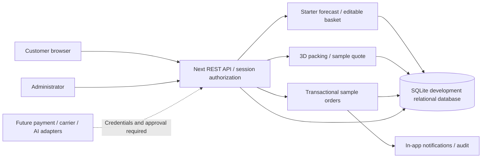

# Deployment and operations

## Supported current deployment

For Vercel with persistent Turso, see [the cloud deployment guide](VERCEL.md). The instructions below describe the local-file deployment option.

Single persistent Node 24 server with a writable `data` volume. Build with `npm ci && npm run build`; start with `npm start` behind an HTTPS reverse proxy. Load private environment variables using the service manager. Do not deploy this SQLite build to ephemeral/serverless instances or multiple replicas. Set `ENABLE_SAMPLE_ORDERS` only in a demonstration environment. HTTPS is required for production Secure cookies. Database initializes and applies migration version 1 on startup.

Production rollout: Phase 1 runs acceptance tests in staging. Phase 2 replaces SQLite with PostgreSQL/Prisma, adds independently tested adapters and jobs, distributed rate limiting, reviewed compliance/tax rules and verified warehouse events. Phase 3 adds historical forecasting and additional markets after route-by-route approval. No current shipping rule is an authoritative import rule.

## Backup and recovery

Stop writes and the service before copying the database and any accompanying WAL/SHM files, or use SQLite's online backup API from a separate operational script. Encrypt backups, restrict access, keep off-host copies and rehearse restoration to staging. Never copy only the main SQLite file while WAL writes are active. Restore to an isolated directory, set DATABASE_PATH, start the service and compare row counts/order totals before switching traffic. Set recovery point/time objectives and backup schedules before launch.

## Admin guide

Provision admin via environment variables; sign in through the same account form. Operations dashboard has schema-validated JSON forms for full catalogue/rule editing. Update stock and product data; review requests through sourcing states. Use sequential order actions; audit trail records product/rule/request/order changes. Overseas checkout is blocked independently of admin-edited sample rules. Do not change that gate until reviewed route eligibility, pricing, taxes and live providers exist.

## Warehouse guide

Current order transitions are manual sample workflow controls available to admins. Review carton packing lists and coordinates in the customer quote preview. Physical weighing, item scanning, carton confirmation, packing list exports and warehouse-specific permissions are pending. Do not use this preview as proof of physical packing or dispatch.

## Integration setup and launch approvals

- Payment provider: merchant jurisdiction/settlement eligibility, onboarding approval, restricted server key and webhook signing secret. Add a replaceable adapter, signature checks, idempotent payment ledger, refunds and reconciliation; never trust redirects as payment confirmation.
- Carrier: commercial account, approved origin/destination services, rate/label/tracking credentials, documented dimensional/weight/girth limits, effective dates and delivery cutoffs.
- Compliance: qualified review of authoritative government and carrier sources; product-level jurisdiction, source URL, reviewed/effective/expiry dates and approval status. Unknown/prohibited must fail closed.
- Tax/food operations: reviewed tax/duty treatment, food labeling/allergen data, supplier approval, lot traceability, storage and recall processes.
- Email/SMS: verified sending domain, provider credentials and consent/preferences; dispatch from durable outbox jobs.
- AI: optional server-only model credential behind a schema-validated adapter; no addresses or personal household details sent by default. Keep deterministic forecast fallback.
- Hosting/monitoring: HTTPS domain, managed PostgreSQL, secrets manager, object storage, error monitoring, distributed abuse controls, audit retention, tested restore and incident plan.

## Security and privacy limits

Scrypt passwords, random hashed sessions, parameterized SQL, server ownership checks, request validation, same-origin mutation checks and in-process auth throttling are included. In-process throttling is not sufficient across replicas. CSP, body-stream caps, reset/MFA, account recovery, consent/export/deletion workflows and formal penetration testing are pending. Implement retention schedules and legal data handling policies before real personal data is accepted. External Google Fonts are used; self-host for controlled production deployments. No card data is accepted or stored.

## Data flow

A Dockerfile is included for a persistent single-instance deployment; the container build has not been executed here. Mount a persistent volume at /app/data, inject private runtime environment variables, and place behind HTTPS. Do not include .env files in the build context (excluded by .dockerignore).

